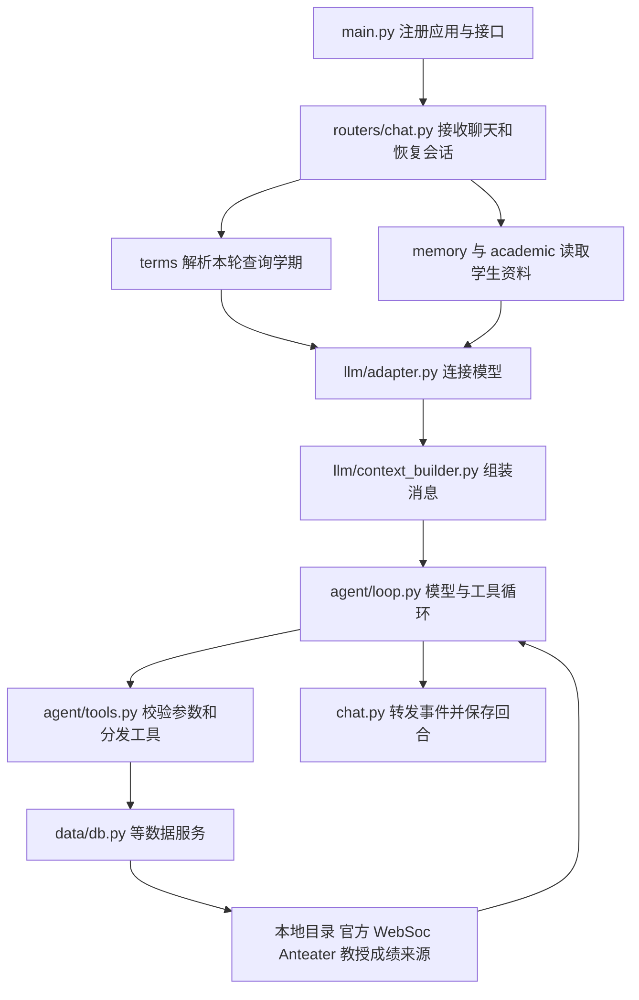

# 后端代码逐文件导览

这份清单用于逐个理解项目的后端实现，并在出现 bug 时找到负责的层。范围是当前工作区的 `main.py` 和 `app/` 全部 105 个 Python 文件，共 106 个文件；`app/` 共 37,696 行。行数和跳转位置以 2026 年 11 月 9 日本次盘点版本为准，包含已有的未提交改动。

这是实现职责与调用路径导览。文件清单逐项覆盖，关键路径追踪到函数；它不等于已完成全部 3.77 万行的正确性审计。此次只新增导览文档，没有修改业务代码。

`static/` 的前端实现留到下一部分。数据文件、历史验收产物、`.local-backups/` 的旧代码副本、虚拟环境和第三方依赖不算当前后端模块。脚本与测试另见 [后端脚本与测试索引](/Users/luoweipotter/Downloads/uci-course-advisor1/docs/backend-scripts-tests-index.md)。

## 一次聊天经过哪些代码

`app/agent/` 是一个包，`loop.py` 是这个包里组织执行循环的文件。它们不是两个并列的 Agent。普通聊天主链如下。



这条链包含两类执行方式：部分来源查询由后端工作流强制先执行；其余工具由模型在循环中选择。开启动态预筛或固定排名的推荐请求，还会接入 `recommendations/` 中的筛选、证据和确定性展示。因此，改 prompt 不一定能改变代码里的硬限制，改数据接口也不一定能修好模型最后的解释。

## 建议逐个阅读的顺序

- [ ] `main.py`：确认应用如何启动、接口如何注册。
- [ ] `routers/chat.py` 的 `_stream_chat` 和 `_handle_agent`：确认一次问题怎样进入后端。
- [ ] `llm/adapter.py` 的 `stream_agent_response` 与 `context_builder.py`：确认模型实际看到了什么。
- [ ] `agent/loop.py` 的 `run_agent` 和 `_run_loop`：确认模型与工具怎样交替运行。
- [ ] `agent/tools.py` 的 `TOOL_SCHEMAS`、`dispatch`、`enforce_query_term_scope`：确认模型能做什么、哪些参数由代码约束。
- [ ] `catalog/types.py`、`departments.py`、`normalization.py`：确认课程、简称、班次的身份。
- [ ] `data/db.py` 的 `get_course_info`、`get_sections`、`get_live_sections`：确认事实从哪里来。
- [ ] 下方课程身份案例：把一个具体功能从输入一路跟到答案。
- [ ] `terms/`：逐项理解默认学期、本轮查询和历史参考。
- [ ] `agent/prefilter.py` 与 `recommendations/`：理解推荐如何筛选、排序、生成结果。
- [ ] `scheduling/service.py` 与 `chat.py` 中的课表函数：理解时间、冲突与已选课。
- [ ] `data/sessions.py`、`modules/state.py`、`memory/`、`academic/`：理解每类学生数据保存在哪里。
- [ ] 官方限制、教授成绩、网络搜索、身份隐私：按下面文件清单逐一勾选。

## 逐文件职责清单

每项包含职责、关键入口及适合从此处开始排查的现象。包入口也计入，避免把空的 `__init__.py` 误当作遗漏。点击文件名可跳到第一个关键入口。

### 启动与公共能力

- [ ] **[main.py](/Users/luoweipotter/Downloads/uci-course-advisor1/main.py:23)**（225 行）

  创建 FastAPI 应用，注册所有接口和静态资源；启动会话学期元数据迁移和后台学期同步，统一处理来源校验、安全响应头、访客 cookie 和请求 trace。

  关键入口：`lifespan`、`security_middleware`。

  排查：服务启动、路由未挂载、跨域请求被拒绝、响应缓存或安全头异常。

- [ ] **[app/config.py](/Users/luoweipotter/Downloads/uci-course-advisor1/app/config.py:32)**（164 行）

  集中读取环境配置，包括运行环境、登录与访客策略、推荐开关、搜索服务和各数据文件路径；多数值在调用时读取。

  关键入口：`recommendation_ranking_enabled`、`dynamic_prefilter_enabled`、`memory_provider`。

  排查：同一代码在本地和部署环境行为不同，先核对这里的默认值及实际环境配置。

- [ ] **[app/observability.py](/Users/luoweipotter/Downloads/uci-course-advisor1/app/observability.py:121)**（391 行）

  为请求和模型调用提供 trace ID、结构化日志、耗时、计数、提示词层级的 token 估算及真实网页请求审计。指标主要保存在当前进程。

  关键入口：`log_event`、`estimate_prompt_layers`、`snapshot_metrics`。

  排查：回答慢、工具失败、模型输入过大、无法确认本轮实际访问过哪些 URL。

- [ ] **[app/response_language.py](/Users/luoweipotter/Downloads/uci-course-advisor1/app/response_language.py:42)**（76 行）

  从本轮用户语言和相关历史确定中文或英文，复用于回答、工具进度、兜底文案和学期显示。

  关键入口：`response_language`、`display_term`。

  排查：中文问题出现英文提示，或中英文切换不一致。

- [ ] **[app/__init__.py](/Users/luoweipotter/Downloads/uci-course-advisor1/app/__init__.py:1)**（0 行）

  空的 Python 包标记，没有业务执行逻辑。

  排查：包入口；通常不从这里排查业务判断。

### 接口层 app routers

- [ ] **[app/routers/chat.py](/Users/luoweipotter/Downloads/uci-course-advisor1/app/routers/chat.py:1114)**（2,602 行）

  主聊天入口：解析用户与会话、读取记忆、确定查询学期、运行 Agent、转发 SSE、保存回合并触发后台反思与标题；同一文件还实现 Continue 和课表增删查刷新。

  关键入口：`_stream_chat`、`_handle_agent`、`add_to_schedule`、`refresh_schedule`。

  排查：没有回答、流式事件丢失、续答或会话恢复异常、加课后消失；需先定位到具体函数，不能把整份文件当一个功能。

- [ ] **[app/routers/sessions.py](/Users/luoweipotter/Downloads/uci-course-advisor1/app/routers/sessions.py:129)**（278 行）

  会话列表、创建、读取、改标题和删除；恢复已存回合与卡片，返回后端默认学期上下文；旧默认学期接口仅允许自动刷新，拒绝手动设置。

  关键入口：`get_session`、`update_default_term`。

  排查：会话串号、恢复内容不同、默认标签异常、卡片恢复行为错误。

- [ ] **[app/routers/memory.py](/Users/luoweipotter/Downloads/uci-course-advisor1/app/routers/memory.py:58)**（254 行）

  展示和修改用户档案、事实及偏好，提供记忆证据列表与软遗忘；经 MemoryManager 操作，部分展示会计算粗略 GE 或专业进度。

  关键入口：`get_memory`、`update_profile`、`forget_memory_item`。

  排查：个人档案没有保存、偏好删不掉、展示的课程或进度与记忆不一致。

- [ ] **[app/routers/academic.py](/Users/luoweipotter/Downloads/uci-course-advisor1/app/routers/academic.py:31)**（89 行）

  接收浏览器已解析的成绩单结构数据；鉴权、限流并串行协调学业快照替换与记忆中的已修课程镜像；读取学业资料时按参数决定是否返回 GPA。

  关键入口：`import_transcript_data`、`academic_profile`。

  排查：导入失败、导入成功后推荐仍用旧已修课程、GPA 显示或权限异常。

- [ ] **[app/routers/auth.py](/Users/luoweipotter/Downloads/uci-course-advisor1/app/routers/auth.py:102)**（198 行）

  注册、登录、退出、当前用户和删除账户 HTTP 接口；注册校验 UCI 邮箱格式和密码确认，直接创建未验证账户并登录。当前注册不发送验证码。

  关键入口：`register`、`login`、`delete_account`。

  排查：注册登录失败、cookie 没写入、删除账户入口异常。

- [ ] **[app/routers/onboarding.py](/Users/luoweipotter/Downloads/uci-course-advisor1/app/routers/onboarding.py:52)**（232 行）

  为档案初始化与编辑提供学院、专业、专业要求、GE、院系和课程列表；数据来自通用学校资料与课程目录封装。

  关键入口：`list_schools`、`list_majors`、`list_all_courses`。

  排查：学院专业列表不正确、课程选择器内容缺失或冷启动慢。

- [ ] **[app/routers/system_info.py](/Users/luoweipotter/Downloads/uci-course-advisor1/app/routers/system_info.py:29)**（89 行）

  提供后端自动学期和当前 Agent 基础提示词，让界面读取统一值。读取提示词不会替代聊天执行入口。

  关键入口：`get_term_state`、`get_system_prompt`。

  排查：界面默认学期元信息错误、设置中显示的基础 prompt 不一致。

- [ ] **[app/routers/health.py](/Users/luoweipotter/Downloads/uci-course-advisor1/app/routers/health.py:17)**（73 行）

  暴露进程存活、目录与记忆及学期状态的 readiness、进程指标。readiness 中的检查范围有限，不能代表所有外部服务正常。

  关键入口：`live`、`ready`、`metrics`。

  排查：部署探针失败、进程在线但关键数据状态异常。

- [ ] **[app/routers/__init__.py](/Users/luoweipotter/Downloads/uci-course-advisor1/app/routers/__init__.py:1)**（0 行）

  空的路由包标记，实际注册在 main.py。

  排查：包入口；通常不从这里排查业务判断。

### Agent 执行层

- [ ] **[app/agent/loop.py](/Users/luoweipotter/Downloads/uci-course-advisor1/app/agent/loop.py:868)**（1,932 行）

  组织多轮模型与工具循环：模型请求工具、程序执行并把结果交回模型；管理固定工作流、查询防重复、预算、错误、卡片事件和续答快照；开启对应推荐模式时接入确定性展示。

  关键入口：`run_agent`、`_run_loop`、`resume_agent`。

  排查：重复查同一数据、没有按流程查来源、达到预算、Continue 丢状态、工具结果已对但答案仍有问题。

- [ ] **[app/agent/tools.py](/Users/luoweipotter/Downloads/uci-course-advisor1/app/agent/tools.py:2669)**（2,806 行）

  定义模型可用工具的 JSON schema，并把工具名分发到 Python 实现；执行后端查询学期限制，连接课程、教授、先修、搜索等服务；推荐工具还组装卡片、选择班次和附加证据。

  关键入口：`dispatch`、`enforce_query_term_scope`、`_tool_propose_recommendation`。

  排查：工具参数不对、擅自换学期、工具不可用、卡片字段或班次选择错误。这已是业务枢纽，远超简单包装层。

- [ ] **[app/agent/workflow_router.py](/Users/luoweipotter/Downloads/uci-course-advisor1/app/agent/workflow_router.py:99)**（311 行）

  维护开发者声明的固定工作流注册表，识别实时余位与院系限制问题，并为需要强制执行的流程建立主工具调用计划；其他问题交给 Agent。

  关键入口：`route_solution`、`build_primary_workflow_plan`。

  排查：限制问题走了泛搜索、没有先读官方来源、工作流误触发或缺信息澄清异常。

- [ ] **[app/agent/prefilter.py](/Users/luoweipotter/Downloads/uci-course-advisor1/app/agent/prefilter.py:62)**（658 行）

  动态推荐预筛的编排：识别推荐意图、解析 Filter Plan、构造候选池并调用纯筛选器；按需补 GE 与配对证据，也拦截绕过 search_courses 的详情或卡片调用。

  关键入口：`initialize`、`search_candidates`、`guard_call`。

  排查：用户条件被忽略、候选被错误排除、事实问答误入推荐、缺少条件仍生成正式推荐。

- [ ] **[app/agent/grade_evidence.py](/Users/luoweipotter/Downloads/uci-course-advisor1/app/agent/grade_evidence.py:50)**（172 行）

  在单轮请求内管理历史给分证据，绑定课程与主讲教授，复用已查结果；仅精确配对被确认无数据时允许退到教授全课程历史。

  关键入口：`get_history`、`find_history`、`prepare_recommendation_grades`。

  排查：助教成绩被当作主讲教授成绩、课程总成绩冒充教授成绩、查询失败却触发扩大范围。

- [ ] **[app/agent/deep_search_state.py](/Users/luoweipotter/Downloads/uci-course-advisor1/app/agent/deep_search_state.py:16)**（241 行）

  保存一次回答中的网页搜索状态，校验父链接、去重 URL、计算访问深度与页面预算，记录本轮实际访问路径。

  关键入口：`DeepSearchRunState`。

  排查：深搜反复抓同一页、跳入未发现的链接、页面数量或深度限制不符合预期。

- [ ] **[app/agent/deep_search_history.py](/Users/luoweipotter/Downloads/uci-course-advisor1/app/agent/deep_search_history.py:21)**（117 行）

  把历史公开搜索路径作为本轮候选线索提供给 Agent，并在结束时记录搜索轨迹；历史内容是证据数据，复用前仍要求本轮重新读取来源。

  关键入口：`load_history_hint`、`record_run_trace`。

  排查：旧搜索被误当成当前事实、历史提示未出现、公开搜索轨迹没有记录。

- [ ] **[app/agent/__init__.py](/Users/luoweipotter/Downloads/uci-course-advisor1/app/agent/__init__.py:1)**（1 行）

  只有包说明；Agent 的实际执行在 loop.py。

  排查：包入口；通常不从这里排查业务判断。

### 模型与提示词 app llm

- [ ] **[app/llm/adapter.py](/Users/luoweipotter/Downloads/uci-course-advisor1/app/llm/adapter.py:1491)**（1,935 行）

  配置 DeepSeek 的 OpenAI 兼容客户端；保存主 Agent 和辅助任务提示词，构造聊天上下文并调用 loop；另有后台偏好反思、会话标题及保留的旧分类和问答函数。

  关键入口：`stream_agent_response`、`get_default_agent_prompt`、`reflect_on_history_llm`。

  排查：模型没启动、提示词约束失效、模型解释课程注释不准确；需区分主链和旧兼容函数。

- [ ] **[app/llm/context_builder.py](/Users/luoweipotter/Downloads/uci-course-advisor1/app/llm/context_builder.py:244)**（401 行）

  把后端指令、时间学期、档案、事实偏好、决策、摘要、近期对话和本轮证据组装成模型 messages；区分程序指令与不可信历史内容。

  关键入口：`build_runtime_context`、`build_messages`。

  排查：模型忘了学生档案、沿用错误上下文、来源内容进入了错误的消息权限层。

- [ ] **[app/llm/intent_rules.py](/Users/luoweipotter/Downloads/uci-course-advisor1/app/llm/intent_rules.py:289)**（346 行）

  使用确定性规则区分单课事实、推荐、课程关系与重复修课等表达；主聊天不再先运行旧 LLM 分类器，但推荐意图判断仍复用这些规则。

  关键入口：`classify_by_rules`、`is_factual_course_identity_query`。

  排查：两门课加“和”就误判推荐、课程更名问题被预筛拦住、明确推荐没有进入推荐。

- [ ] **[app/llm/filter_plan.py](/Users/luoweipotter/Downloads/uci-course-advisor1/app/llm/filter_plan.py:96)**（144 行）

  用一次有时限的辅助模型调用把当前推荐请求转换成有限字段的 Filter Plan，再交给确定性校验；解析失败返回明确状态。

  关键入口：`parse_filter_plan`。

  排查：自然语言时间偏好或 GE 诉求解析错、超时、未解析成功仍声称满足硬条件。

- [ ] **[app/llm/safety.py](/Users/luoweipotter/Downloads/uci-course-advisor1/app/llm/safety.py:36)**（52 行）

  定义应用不可被自定义 prompt 覆盖的指令边界，把历史、网页和扩展设置序列化为数据上下文。

  关键入口：`with_system_safety`、`untrusted_context_message`。

  排查：记忆或网页中的文本被当成应用指令、自定义设置覆盖了规则。

- [ ] **[app/llm/__init__.py](/Users/luoweipotter/Downloads/uci-course-advisor1/app/llm/__init__.py:1)**（0 行）

  空的模型包标记。

  排查：包入口；通常不从这里排查业务判断。

### 课程目录 app catalog

- [ ] **[app/catalog/types.py](/Users/luoweipotter/Downloads/uci-course-advisor1/app/catalog/types.py:49)**（167 行）

  定义课程标识、课程资料、学期班次与来源类型；CourseRef 仅由院系和课号构成，班次另有 term_id 和 section_id。

  关键入口：`CourseRef`、`CourseRecord`、`SectionRecord`。

  排查：同课识别、课程与班次混淆、字段丢失；先弄清数据对象再改逻辑。

- [ ] **[app/catalog/departments.py](/Users/luoweipotter/Downloads/uci-course-advisor1/app/catalog/departments.py:106)**（167 行）

  维护院系简称到标准名称的映射，例如 CS→COMPSCI、ICS→I&C SCI、INF→IN4MATX；也从本地目录补标准院系代码，并生成聊天用简称。

  关键入口：`resolve_department`、`colloquial_course_id`。

  排查：用户写法无法匹配、合法院系被漏掉、注释里的简称和用户课号接不上。

- [ ] **[app/catalog/normalization.py](/Users/luoweipotter/Downloads/uci-course-advisor1/app/catalog/normalization.py:52)**（277 行）

  从文本解析并规范课程引用，也规范教授名和抽取教授提及；课程解析结合院系别名，不负责认定不同标准课号等价。

  关键入口：`parse_course_mention`、`iter_course_mentions`。

  排查：ICS33 与 I&C SCI 33 未匹配、中文紧邻课号解析失败、教授文本解析异常。

- [ ] **[app/catalog/ge.py](/Users/luoweipotter/Downloads/uci-course-advisor1/app/catalog/ge.py:18)**（39 行）

  统一 GE 标签的字符串、分隔符或 JSON 数组写法，保留不能识别的标签。语法规范化不等于官方认证或个人学分抵扣。

  关键入口：`parse_ge_categories`。

  排查：多 GE 标签丢失、标签格式混乱。

- [ ] **[app/catalog/term.py](/Users/luoweipotter/Downloads/uci-course-advisor1/app/catalog/term.py:22)**（105 行）

  本地目录使用的学期类型、解析和已载入学期注册表，存储格式形如 2026_Fall；不负责产品第八周默认学期规则。

  关键入口：`Term`、`TermRegistry`。

  排查：CSV 学期键不匹配、目录可用学期列表不正确。

- [ ] **[app/catalog/view.py](/Users/luoweipotter/Downloads/uci-course-advisor1/app/catalog/view.py:28)**（105 行）

  把某一目标学期的课程与班次按 CourseRef 建索引，同时建立教授检索索引，提供课程存在性、班次和教授查询。

  关键入口：`CatalogView`。

  排查：目录明明有记录却查不到、某学期班次被挂到错误课程。

- [ ] **[app/catalog/cache.py](/Users/luoweipotter/Downloads/uci-course-advisor1/app/catalog/cache.py:27)**（92 行）

  注册数据加载器，按学期懒构建并缓存 CatalogView。当前默认注册本地关系型 CSV 加载器。

  关键入口：`CatalogCache`、`get_catalog`。

  排查：更新 CSV 后进程仍读旧视图、某学期没有建出目录。

- [ ] **[app/catalog/coverage.py](/Users/luoweipotter/Downloads/uci-course-advisor1/app/catalog/coverage.py:27)**（177 行）

  生成或读取本地数据覆盖信息，区分完整、部分、过期与不可用；不能根据总行数推断院系覆盖完整。

  关键入口：`get_coverage_manifest`、`get_term_coverage`。

  排查：把本地缺记录误判成未开课、过期课表仍当当前数据。

- [ ] **[app/catalog/loaders/base.py](/Users/luoweipotter/Downloads/uci-course-advisor1/app/catalog/loaders/base.py:18)**（37 行）

  规定数据源加载器的接口，包括可用学期和按学期返回课程与班次；新增来源要对齐这个约定。

  关键入口：`CatalogLoader`。

  排查：接入新数据源时的对象或接口不一致。

- [ ] **[app/catalog/loaders/uci_relational.py](/Users/luoweipotter/Downloads/uci-course-advisor1/app/catalog/loaders/uci_relational.py:167)**（368 行）

  读取 courses、sections、section_instructors、section_ge 四类 CSV，按目标学期组装规范课程和班次，保留先修树、完整 meetings、原注释及来源。

  关键入口：`UCIRelationalLoader`。

  排查：CSV 有字段但 API 丢失、班次与教授关联错、旧 CSV 与新版字段兼容出问题。

- [ ] **[app/catalog/__init__.py](/Users/luoweipotter/Downloads/uci-course-advisor1/app/catalog/__init__.py:1)**（22 行）

  统一导出 CourseRef、目录查询、覆盖信息和规范化函数，导入 cache 时也会触发默认加载器注册。

  排查：包入口；通常不从这里排查业务判断。

- [ ] **[app/catalog/loaders/__init__.py](/Users/luoweipotter/Downloads/uci-course-advisor1/app/catalog/loaders/__init__.py:1)**（6 行）

  导出加载器基类与本地 CSV 实现。

  排查：包入口；通常不从这里排查业务判断。

### 数据查询入口 app data

- [ ] **[app/data/db.py](/Users/luoweipotter/Downloads/uci-course-advisor1/app/data/db.py:338)**（1,193 行）

  应用统一数据访问门面，名字虽叫 db，实际连接本地目录、官方 WebSoc、Anteater、教授与成绩及档案；元数据查询与学期班次查询分开，并保留来源和失败状态。

  关键入口：`get_course_info`、`get_sections`、`get_live_sections`、`check_prerequisites_met`。

  排查：先判断请求哪类数据，再查这里走了哪个来源分支；常见于开课状态、字段遗漏、回退和缓存错误。

- [ ] **[app/data/anteater.py](/Users/luoweipotter/Downloads/uci-course-advisor1/app/data/anteater.py:552)**（711 行）

  Anteater HTTP 客户端及响应整理；提供课程、普通班次、实时班次、校历和可用学期，含缓存、请求审计和结构校验。

  关键入口：`fetch_sections`、`fetch_live_sections`、`fetch_calendar_all`。

  排查：上游 API 参数、嵌套数据展开、实时缓存、取消状态或原始注释丢失。

- [ ] **[app/data/offerings.py](/Users/luoweipotter/Downloads/uci-course-advisor1/app/data/offerings.py:56)**（94 行）

  按每个查询学期分别拿班次，归纳开课状态和主讲教授；区分未开课、未公布与不可用，未来未公布时单列前两年同季历史参考。

  关键入口：`get_course_offerings`、`summarize_offering`。

  排查：跨学期比较漏了一季、助教混入教授、把历史记录写成未来开课事实。

- [ ] **[app/data/course_changes.py](/Users/luoweipotter/Downloads/uci-course-advisor1/app/data/course_changes.py:19)**（80 行）

  旧代码查无班次且没有现成课程注释时，在同一目标学期全部院系的 courseComment 中反向找提到该旧代码的课程；返回候选注释，缓存两学期且五分钟有效。

  关键入口：`find_related_notices`、`attach_related_notices`。

  排查：只给旧编号时找不到新编号、错误地把任何提及当成更名；这里不建立永久等价表。

- [ ] **[app/data/websoc_payload.py](/Users/luoweipotter/Downloads/uci-course-advisor1/app/data/websoc_payload.py:18)**（235 行）

  保留学院、院系、编号范围、课程与班次注释；压缩重复上下文并生成可回指原文的 course_code_normalizations；也保持取消状态的未知值。

  关键入口：`course_comment_context`、`compact_comment_contexts`。

  排查：注释作用域丢失、INF 43 简称无法解释、模型收到的注释与原始来源不同。

- [ ] **[app/data/__init__.py](/Users/luoweipotter/Downloads/uci-course-advisor1/app/data/__init__.py:1)**（0 行）

  空的数据包标记；不代表所有数据都从同一个数据库读取。

  排查：包入口；通常不从这里排查业务判断。

### 官方课表与限制

- [ ] **[app/data/websoc_workflow.py](/Users/luoweipotter/Downloads/uci-course-advisor1/app/data/websoc_workflow.py:306)**（2,284 行）

  固定请求 Registrar WebSoc 表单并提交官方查询，解析开课、班次、限制和完整页面证据；按允许范围跟进相关官方链接及同学期 co-class 引用。

  关键入口：`fetch_websoc_course_offering`、`fetch_websoc_department_restrictions`、`parse_websoc_course_html`。

  排查：官方课表解析错、把网络失败当没开课、限制来源没有抓到、相关班次查询范围错误。

- [ ] **[app/data/websoc_pairing.py](/Users/luoweipotter/Downloads/uci-course-advisor1/app/data/websoc_pairing.py:114)**（449 行）

  从完整官方课表的原始表格行与说明生产按主班区分的配对证据，应用已确认的 Dis 存在性产品规则，并合并同学期官方引用快照。

  关键入口：`produce_websoc_pairing`、`resolve_pairing_references`。

  排查：Lec 与 Dis/Lab 关系错误、局部页被误判无需 Dis、co-class 被误当成同一课程。

- [ ] **[app/data/restriction_timeline.py](/Users/luoweipotter/Downloads/uci-course-advisor1/app/data/restriction_timeline.py:941)**（1,135 行）

  把限制类型、日期时间、适用对象、课程范围与例外解析成类型化事件，检查证据完整性并生成确定性的核心事实。

  关键入口：`parse_restriction_timeline`、`build_restriction_evidence_bundle`、`build_verified_restriction_facts`。

  排查：专业限制与 New Only 混淆、解除时间串行、例外范围丢失。

- [ ] **[app/data/policies.py](/Users/luoweipotter/Downloads/uci-course-advisor1/app/data/policies.py:862)**（907 行）

  保存手工整理的学校政策、限制代码、学籍与校历等常量，附来源，并提供政策学期与期限辅助函数；由 get_policy 工具按主题读取。

  关键入口：`get_term_calendar`、`is_term_past_deadline`。

  排查：固定政策或限制代码解释错误；这里含硬编码内容，修改前需核对适用年份和来源。

- [ ] **[app/data/prerequisites.py](/Users/luoweipotter/Downloads/uci-course-advisor1/app/data/prerequisites.py:80)**（402 行）

  评估结构化先修树的 AND、OR、NOT、最低成绩及考试等条件，返回 met、not_met、unknown；没有完整证据时保留未知。

  关键入口：`evaluate_prerequisite_tree`。

  排查：满足 OR 的一支仍被拒绝、缺成绩被当通过、在修或考试证据处理错误。

### 成绩教授与推荐数据

- [ ] **[app/data/grades.py](/Users/luoweipotter/Downloads/uci-course-advisor1/app/data/grades.py:443)**（465 行）

  查询与磁盘缓存 Anteater 的课程历史成绩汇总，整理分布与 GPA 字段；是课程整体历史口径。

  关键入口：`get_grade_distribution`。

  排查：课程成绩图或统计异常、缓存没有更新；不能由此认定某位教授的成绩。

- [ ] **[app/data/zotistics.py](/Users/luoweipotter/Downloads/uci-course-advisor1/app/data/zotistics.py:466)**（511 行）

  读取原 Zotistics 网站返回的历史图表数据，支持课程、教授或精确配对，保留样本、覆盖、来源和无数据或失败状态；不自行扩大查询范围。

  关键入口：`get_grade_distribution`、`get_cached_query_result`。

  排查：教授匹配、样本分母、课程与教授范围、原站结构变化。

- [ ] **[app/data/professors.py](/Users/luoweipotter/Downloads/uci-course-advisor1/app/data/professors.py:350)**（639 行）

  读取本地 RMP 教授档案和评论 SQLite，做姓名与院系消歧、评分身份核对、评论和标签聚合。

  关键入口：`lookup_professor`、`verify_rating_identity`、`get_reviews`。

  排查：同姓教授串人、评分和评论不属于所问教授、评论课程过滤错误。

- [ ] **[app/data/professor_summary.py](/Users/luoweipotter/Downloads/uci-course-advisor1/app/data/professor_summary.py:198)**（331 行）

  把已有学生评论通过辅助模型整理为优缺点、适合或不适合的结构化摘要，按教授与课程及提示词版本缓存。

  关键入口：`summarize_professor`。

  排查：摘要与原评论不符、改了提示词仍出现旧摘要、摘要调用失败。

- [ ] **[app/data/recommendations.py](/Users/luoweipotter/Downloads/uci-course-advisor1/app/data/recommendations.py:27)**（132 行）

  把完整的目标学期候选池、主班、历史成绩缓存和本地教授评分整理给确定性排名器，再选不同课程；默认排名读取快照，不为全目录逐课联网。

  关键入口：`rank_courses`。

  排查：搜索只看前 30 门、排名用错教授、候选池与最终排序衔接错误。

- [ ] **[app/data/ge_evidence.py](/Users/luoweipotter/Downloads/uci-course-advisor1/app/data/ge_evidence.py:215)**（251 行）

  按修课目标学年的官方 Catalogue 取得课程 GE 证明，校验来源、版本和覆盖年份，缓存整版目录以复用。

  关键入口：`get_course_ge_evidence`、`verified_ge_provenance`。

  排查：GE 标签来自错误学年、旧 CSV 标签被当已认证、课程多标签丢失。

### 通用网络检索

- [ ] **[app/data/web_search.py](/Users/luoweipotter/Downloads/uci-course-advisor1/app/data/web_search.py:175)**（760 行）

  受配置控制的搜索入口，支持离线 fake 与 DuckDuckGo 等已实现提供方，统一搜索结果来源分类、可信级别、限流与失败响应。

  关键入口：`search_web`、`classify_url`。

  排查：没有搜索结果、配置选了未实现服务、论坛内容被当成官方证据。

- [ ] **[app/data/deep_search.py](/Users/luoweipotter/Downloads/uci-course-advisor1/app/data/deep_search.py:175)**（674 行）

  获取一个公开网页，校验 URL 与网络地址、处理重定向并提取有长度上限的正文与链接；不负责整轮搜索预算。

  关键入口：`fetch_page`、`validate_public_url`。

  排查：网页取不到、正文清洗错误、重定向或 URL 被拦截。

- [ ] **[app/data/deep_search_history.py](/Users/luoweipotter/Downloads/uci-course-advisor1/app/data/deep_search_history.py:149)**（431 行）

  用 SQLite 保存符合规则的公开搜索轨迹、URL 与答案摘要，以本地词项、实体和散列向量做相似检索；含个人上下文的轨迹被排除。

  关键入口：`DeepSearchHistoryStore`、`similarity`。

  排查：搜索历史召回或相似度异常、公开路径存储错误；不同于学生长期记忆。

### 学校基础资料

- [ ] **[app/data/uci_general/anteater_programs.py](/Users/luoweipotter/Downloads/uci-course-advisor1/app/data/uci_general/anteater_programs.py:134)**（466 行）

  封装专业、要求树、GE 和课程选择器数据；全课程列表优先本地 CSV，其次重启可用的运行缓存，最后才分页抓 API。

  关键入口：`majors`、`major`、`ge_requirements`、`list_all_courses`。

  排查：专业要求列表、全课程选择器、冷启动全目录抓取异常。

- [ ] **[app/data/uci_general/colleges.py](/Users/luoweipotter/Downloads/uci-course-advisor1/app/data/uci_general/colleges.py:173)**（193 行）

  手工维护学院信息及院系到学院的映射，用于档案选择与专业筛选。

  关键入口：`school_for_dept`、`departments_by_school`。

  排查：院系分进错误学院、新院系没有归属。

- [ ] **[app/data/uci_general/ge_policy.py](/Users/luoweipotter/Downloads/uci-course-advisor1/app/data/uci_general/ge_policy.py:121)**（176 行）

  手工编码 GE 类别、最低门数和简单已完成门数进度，可处理指定 AP 抵免输入。不是完整的官方学位审计。

  关键入口：`all_categories`、`progress`。

  排查：档案面板中的 GE 类别或进度计数错误。

- [ ] **[app/data/uci_general/major_requirements/__init__.py](/Users/luoweipotter/Downloads/uci-course-advisor1/app/data/uci_general/major_requirements/__init__.py:45)**（244 行）

  注册人工整理的专业要求，找不到时读抓取的原始 JSON；收集专业涉及课程，对人工规则计算粗略完成进度。

  关键入口：`get_major`、`compute_progress`。

  排查：专业规则加载错、专业进度粗算不符合录入数据；不能扩展成官方毕业资格证明。

- [ ] **[app/data/uci_general/major_requirements/cs_bs.py](/Users/luoweipotter/Downloads/uci-course-advisor1/app/data/uci_general/major_requirements/cs_bs.py:213)**（239 行）

  手工编码 2025 至 2026 版 CS 本科要求，包括全修、选修组、方向等结构；供注册表和粗略进度读取。

  关键入口：`get`、`all_required_anywhere`。

  排查：CS 要求内容、选项组、适用目录年份错误。

- [ ] **[app/data/uci_general/__init__.py](/Users/luoweipotter/Downloads/uci-course-advisor1/app/data/uci_general/__init__.py:1)**（0 行）

  空的学校通用资料包标记。

  排查：包入口；通常不从这里排查业务判断。

### 确定性推荐规则 app recommendations

- [ ] **[app/recommendations/filter_plan.py](/Users/luoweipotter/Downloads/uci-course-advisor1/app/recommendations/filter_plan.py:99)**（362 行）

  定义允许的推荐目标、硬约束和软偏好；校验模型 JSON 与本轮原句，识别可信 GE 审计和未解决的约束，不接受模型自创规则。

  关键入口：`FilterPlan`、`validate_filter_plan`。

  排查：软偏好变硬排除、旧聊天被当本轮授权、缺审计却按剩余 GE 排除课程。

- [ ] **[app/recommendations/prefilter.py](/Users/luoweipotter/Downloads/uci-course-advisor1/app/recommendations/prefilter.py:262)**（348 行）

  纯规则筛选器：只根据传入的计划和课程证据处理已修、先修、开课、GE、时间及配对等条件，返回保留、排除和待核实原因；自身不查网络或档案。

  关键入口：`apply_dynamic_prefilter`。

  排查：某门课为何被排除、TBA 被误删、明确硬条件没有应用。

- [ ] **[app/recommendations/features.py](/Users/luoweipotter/Downloads/uci-course-advisor1/app/recommendations/features.py:129)**（149 行）

  把外部提供的历史成绩和 RMP 快照转成排名特征，校验来源范围、样本和数值；不联网，不猜目标学期教授。

  关键入口：`build_candidate_features`。

  排查：原始数据没问题但排名输入有问题、无数据被变成零分。

- [ ] **[app/recommendations/ranking.py](/Users/luoweipotter/Downloads/uci-course-advisor1/app/recommendations/ranking.py:98)**（148 行）

  纯数学排序：默认 A 比例权重 0.6、教授评分 0.4，按样本量向中点收缩；缺失特征重新分配权重，无可用特征时保留无分状态。

  关键入口：`rank_candidates`。

  排查：分数和排序不符合预期、样本量影响不清楚；目标标签本身不会自动改权重。

- [ ] **[app/recommendations/pairing.py](/Users/luoweipotter/Downloads/uci-course-advisor1/app/recommendations/pairing.py:311)**（445 行）

  规范并校验服务端的配对证据，绑定课程、学期和主班；检查选中组合是否完整并保留未知，支持旧版与按主班区分的新版证据。

  关键入口：`normalize_pairing_evidence`、`verify_selection`。

  排查：切换 Lec 后沿用旧 Dis 证明、证据跨学期或跨课程、缺组件仍标已验证。

- [ ] **[app/recommendations/presentation.py](/Users/luoweipotter/Downloads/uci-course-advisor1/app/recommendations/presentation.py:280)**（587 行）

  开启对应推荐模式时，依据已选主班及结构化证据生成公开推荐文字和卡片理由，处理 GE、给分、配对与未知状态；不采纳模型自由编写的理由作为事实。

  关键入口：`normalize_recommendation_card`、`render_recommendation_answer`。

  排查：卡片与正文教授不同、历史数据被说成未来事实、内部诊断泄漏给用户。

- [ ] **[app/recommendations/__init__.py](/Users/luoweipotter/Downloads/uci-course-advisor1/app/recommendations/__init__.py:1)**（6 行）

  导出纯排名的默认参数和 rank_candidates。

  排查：包入口；通常不从这里排查业务判断。

### 排课领域 app scheduling

- [ ] **[app/scheduling/service.py](/Users/luoweipotter/Downloads/uci-course-advisor1/app/scheduling/service.py:161)**（1,168 行）

  集中解析日期与 WebSoc 时间，遍历全部 meetings，判断同学期上课与考试冲突，并校验班次取消、满员与配对证据；供工具、卡片和课表 API 复用。这里不评估先修，先修由 data/prerequisites.py 及其调用方处理。

  关键入口：`section_meetings`、`validate_schedule_bundle`、`find_conflicts`。

  排查：日历时间偏移、第二个 meeting 漏冲突、TBA 被当无冲突、不同学期互相冲突。

- [ ] **[app/scheduling/__init__.py](/Users/luoweipotter/Downloads/uci-course-advisor1/app/scheduling/__init__.py:1)**（39 行）

  统一导出时间解析、meeting、冲突与方案校验接口。

  排查：包入口；通常不从这里排查业务判断。

### 学期领域 app terms

- [ ] **[app/terms/models.py](/Users/luoweipotter/Downloads/uci-course-advisor1/app/terms/models.py:51)**（164 行）

  定义产品统一的 YYYY Quarter 学期键、常规学期前后关系、带校历与可用性证据的学期，以及解析结果和错误类型。

  关键入口：`TermKey`、`ResolvedTerm`、`TermParseResult`。

  排查：学期字段混淆、跨年规则或规范格式错误。

- [ ] **[app/terms/clock.py](/Users/luoweipotter/Downloads/uci-course-advisor1/app/terms/clock.py:18)**（31 行）

  提供 America/Los_Angeles 系统时钟和测试可注入的固定时钟，统一时区及夏令时基础。

  关键入口：`SystemClock`、`FixedClock`。

  排查：美西午夜边界或测试日期不稳定。

- [ ] **[app/terms/calendar.py](/Users/luoweipotter/Downloads/uci-course-advisor1/app/terms/calendar.py:15)**（66 行）

  根据 instruction start 计算第八教学周周一切换点，也保留第二周周五期限的计算辅助函数；默认标签切换时间与具体注册窗口是不同概念。

  关键入口：`calculate_week8_cutoff`、`calculate_week2_friday_cutoff`。

  排查：第八周边界差一周、Fall 开头短周或 DST 算错。

- [ ] **[app/terms/parser.py](/Users/luoweipotter/Downloads/uci-course-advisor1/app/terms/parser.py:180)**（260 行）

  确定性解析显式年份季节、相对学期和年份等文本，输出一个或多个规范学期或结构化错误。

  关键入口：`parse_term_text`、`parse_term_key`。

  排查：用户明确时间没被识别、两个学期只剩一个、Summer 或歧义输入被默默忽略。

- [ ] **[app/terms/query_scope.py](/Users/luoweipotter/Downloads/uci-course-advisor1/app/terms/query_scope.py:187)**（310 行）

  为每轮确定 query_terms，处理明确时间、指定历史范围、历史规律、相关追问和默认值，并产出下一轮 recent_query_focus；不写会话存储。

  关键入口：`resolve_query_scope`、`next_recent_focus_terms`。

  排查：查错年份、沿用无关旧问题、历史范围没展开；已知反例以 term-rules 文档为准。

- [ ] **[app/terms/intent.py](/Users/luoweipotter/Downloads/uci-course-advisor1/app/terms/intent.py:37)**（101 行）

  在确定性结果允许的范围内，用辅助模型补充间接追问和开课规律意图，并限制其不能覆盖已有明确解析。

  关键入口：`refine_query_scope`、`apply_semantic_plan`。

  排查：间接追问没沿用目标、语义步骤覆盖了代码确认的时间范围。

- [ ] **[app/terms/service.py](/Users/luoweipotter/Downloads/uci-course-advisor1/app/terms/service.py:84)**（361 行）

  统一计算实际 current_term、规划 automatic/default term、相对学期基准以及未来状态；默认在第八周切换，与课表是否公布分开。

  关键入口：`TermResolutionService`。

  排查：标签提前或延后、“本学期”误用规划默认、假期仍说有当前学期。

- [ ] **[app/terms/store.py](/Users/luoweipotter/Downloads/uci-course-advisor1/app/terms/store.py:17)**（129 行）

  保存自动学期与校历同步快照，提供原子 JSON 替换及进程内同步锁，也提供测试用内存实现。

  关键入口：`TermStateSnapshot`、`JsonFileTermStateStore`。

  排查：运行缓存损坏、同步状态没落盘、并发同步竞争。

- [ ] **[app/terms/sync.py](/Users/luoweipotter/Downloads/uci-course-advisor1/app/terms/sync.py:95)**（302 行）

  从 Anteater 同步校历、可选学期和数据可用性，管理 30 天刷新与 45 天旧成功数据使用期限，无法恢复时标记代码兜底。

  关键入口：`TermStateSynchronizer`、`fallback_state`。

  排查：校历过期、长期不更新、来源变成 code_fallback；兜底不是新的学期业务规则。

- [ ] **[app/terms/conversation.py](/Users/luoweipotter/Downloads/uci-course-advisor1/app/terms/conversation.py:34)**（100 行）

  唯一允许改写会话默认学期元数据的领域入口；同步自动默认、拒绝旧客户端的手动设置并支持恢复自动。

  关键入口：`sync_automatic_default`、`set_manual_default`。

  排查：一次历史提问改掉默认标签、旧手动选择仍生效。

- [ ] **[app/terms/__init__.py](/Users/luoweipotter/Downloads/uci-course-advisor1/app/terms/__init__.py:1)**（50 行）

  统一导出学期模型、时钟、解析、查询范围和存储接口。

  排查：包入口；通常不从这里排查业务判断。

### 会话和学生记忆

- [ ] **[app/data/sessions.py](/Users/luoweipotter/Downloads/uci-course-advisor1/app/data/sessions.py:191)**（528 行）

  用每会话的 meta.json、state.json、turns.jsonl 保存标题和学期元信息、结构化规划状态、用户及助手回合与附加卡片等；含旧学期元数据迁移。

  关键入口：`create_session`、`append_turn`、`update_session_state`。

  排查：刷新丢聊天、跨会话串状态、卡片未持久化、会话文件写入异常。

- [ ] **[app/modules/state.py](/Users/luoweipotter/Downloads/uci-course-advisor1/app/modules/state.py:53)**（164 行）

  旧会话 API 的兼容门面，实际读写 sessions 的 state.json；维护允许的规划字段并从档案预填。add_message 是已弃用的空操作。

  关键入口：`get_or_create_session`、`update_session`、`get_known_fields`。

  排查：聊天状态与持久化不一致；不要再往这里加第二份聊天记录或内存会话真源。

- [ ] **[app/modules/decision_detector.py](/Users/luoweipotter/Downloads/uci-course-advisor1/app/modules/decision_detector.py:107)**（144 行）

  用规则识别“我决定选”“I'll take”“drop”等承诺，提取待固定的会话决策，由聊天路由持久化。

  关键入口：`detect_decisions`。

  排查：用户确认选课后追问又忘记、普通提问被误记成决定。

- [ ] **[app/memory/base.py](/Users/luoweipotter/Downloads/uci-course-advisor1/app/memory/base.py:26)**（208 行）

  定义长期记忆实现必须提供的生命周期、档案、事实偏好、召回和遗忘接口。

  关键入口：`MemoryProvider`。

  排查：新增或替换记忆后端时接口不一致。

- [ ] **[app/memory/manager.py](/Users/luoweipotter/Downloads/uci-course-advisor1/app/memory/manager.py:25)**（301 行）

  选择并统一调用一个记忆 provider，管理会话初始化、回合计数和后台反思触发，包装档案更新及遗忘。默认选择 SQLite，也支持 JSON。

  关键入口：`MemoryManager`、`get_memory_manager`。

  排查：记忆没有载入、反思没有触发、换后端后行为不一致。

- [ ] **[app/memory/sqlite_provider.py](/Users/luoweipotter/Downloads/uci-course-advisor1/app/memory/sqlite_provider.py:112)**（1,024 行）

  默认长期记忆后端：SQLite 与 FTS5，保存档案及带来源、置信度、状态和版本的事实偏好；支持相关召回、冲突版本、软遗忘和旧 JSON 懒迁移。

  关键入口：`SQLiteMemoryProvider`。

  排查：错误偏好反复出现、冲突被覆盖、来源追不回、迁移或召回异常。

- [ ] **[app/memory/json_provider.py](/Users/luoweipotter/Downloads/uci-course-advisor1/app/memory/json_provider.py:179)**（547 行）

  可选的旧文件记忆后端，以用户目录保存 profile、facts、preferences 和旧日志；作为兼容、回退与迁移来源，实际启用取决于配置。

  关键入口：`JSONFileMemoryProvider`。

  排查：显式选择 JSON 模式时的保存读取问题，或旧数据迁移异常。

- [ ] **[app/modules/__init__.py](/Users/luoweipotter/Downloads/uci-course-advisor1/app/modules/__init__.py:1)**（0 行）

  空的兼容模块包标记。

  排查：包入口；通常不从这里排查业务判断。

- [ ] **[app/memory/__init__.py](/Users/luoweipotter/Downloads/uci-course-advisor1/app/memory/__init__.py:1)**（11 行）

  导出 MemoryProvider 和 get_memory_manager。

  排查：包入口；通常不从这里排查业务判断。

### 成绩单学业存储 app academic

- [ ] **[app/academic/models.py](/Users/luoweipotter/Downloads/uci-course-advisor1/app/academic/models.py:63)**（75 行）

  定义成绩单导入允许提交的课程、成绩、学分、考试转学与汇总字段；排除原始 PDF、姓名、学号和原始全文。

  关键入口：`TranscriptImportRequest`、`TranscriptCourseInput`。

  排查：导入 HTTP 校验失败、新增解析字段无法提交。

- [ ] **[app/academic/store.py](/Users/luoweipotter/Downloads/uci-course-advisor1/app/academic/store.py:253)**（727 行）

  SQLite 学业数据存储，解析有效课程记录与重复修课标记；一次成功导入替换整个学业快照，处理请求幂等并在提交前同步已修镜像；提供界面资料和 AI 字段白名单。

  关键入口：`import_transcript`、`get_academic_profile`、`get_ai_academic_context`。

  排查：导入后遗留上一份课程、重复请求覆盖新资料、成绩和学分错误、AI 收到了不应有的字段。

- [ ] **[app/academic/__init__.py](/Users/luoweipotter/Downloads/uci-course-advisor1/app/academic/__init__.py:1)**（15 行）

  导出导入、资料读取、AI 上下文及删除函数。

  排查：包入口；通常不从这里排查业务判断。

### 身份与隐私

- [ ] **[app/auth/security.py](/Users/luoweipotter/Downloads/uci-course-advisor1/app/auth/security.py:71)**（147 行）

  密码 bcrypt 哈希与校验、签名登录及访客 cookie 的生成和有效性验证，也保留旧验证码哈希工具。

  关键入口：`hash_password`、`sign_session`、`verify_session`。

  排查：正确密码无法登录、会话过期或签名失败、访客身份验证异常。

- [ ] **[app/auth/deps.py](/Users/luoweipotter/Downloads/uci-course-advisor1/app/auth/deps.py:94)**（112 行）

  FastAPI 依赖：从 cookie 解析当前用户，按配置决定是否允许访客或共享演示身份；受保护接口强制已登录。

  关键入口：`current_user_required`、`current_user_optional`。

  排查：用户身份来源不对、匿名用户错误进入或被拒绝、不同用户数据隔离异常。

- [ ] **[app/auth/store.py](/Users/luoweipotter/Downloads/uci-course-advisor1/app/auth/store.py:125)**（228 行）

  SQLite 账户存储与旧表升级，保存用户和密码哈希；新账户不声称邮箱已验证，保留历史验证码表和辅助函数。

  关键入口：`create_user`、`find_user_by_email`。

  排查：重复邮箱、旧账户数据库升级、账户记录或验证状态错误。

- [ ] **[app/auth/rate_limit.py](/Users/luoweipotter/Downloads/uci-course-advisor1/app/auth/rate_limit.py:35)**（51 行）

  按操作和客户端或用户键实行进程内固定窗口限流，读取服务端解析后的客户端 IP。

  关键入口：`check_rate_limit`、`client_ip`。

  排查：正常请求被 429、注册限流没有生效或部署代理 IP 配置不符。

- [ ] **[app/auth/email_sender.py](/Users/luoweipotter/Downloads/uci-course-advisor1/app/auth/email_sender.py:33)**（105 行）

  旧验证码邮件发送抽象，开发日志模式或 Resend HTTP；当前注册登录主流程没有调用它。

  关键入口：`send_verification_code`。

  排查：只在恢复邮件验证或维护旧流程时重点阅读，不能把它当当前注册的必要步骤。

- [ ] **[app/privacy/deletion.py](/Users/luoweipotter/Downloads/uci-course-advisor1/app/privacy/deletion.py:43)**（56 行）

  删除用户学业数据、SQLite 记忆、用户会话目录，最后删除账户记录；通过用户路径校验约束目录删除范围。

  关键入口：`delete_account_data`。

  排查：账户删了但资料还在，或删除流程中途失败。

- [ ] **[app/auth/__init__.py](/Users/luoweipotter/Downloads/uci-course-advisor1/app/auth/__init__.py:1)**（0 行）

  空的身份模块包标记。

  排查：包入口；通常不从这里排查业务判断。

- [ ] **[app/privacy/__init__.py](/Users/luoweipotter/Downloads/uci-course-advisor1/app/privacy/__init__.py:1)**（1 行）

  只有隐私操作的包说明。

  排查：包入口；通常不从这里排查业务判断。

## 课程跨学期识别的实际实现

### 先区分三种编号

| 对象 | 示例 | 当前如何识别 |
| --- | --- | --- |
| 同一个标准课号的不同写法 | ICS33、ICS 33、I&C SCI 33 | `departments.py` 的院系别名加 `normalization.py` 的解析，得到相同 `CourseRef("I&C SCI", "33")`。 |
| 同一标准课号在不同学期的开课 | 2026 Winter 的 I&C SCI 33 与 2026 Fall 的 I&C SCI 33 | 同一个 CourseRef，分别进入不同学期的目录或来源查询；教授、时间、名额和班次仍分别读取。 |
| 院系或课号实际发生变化 | IN4MATX 43 与 SWE 43 | 两个不同 CourseRef；简称表不会把它们合并。当前通过目标学期官方注释寻找关系，再由模型解释明确文字。 |

`CourseRef` 的相等与哈希仅取标准院系和课号，不含学期。这是“同一个标准课号”的程序定义，并不是对课程内容、学分规则在多年间恒定不变的证明。

五位 WebSoc code 是班次编号，不是永久课程 ID。`SectionRecord` 同时保存 `term_id`，其复合 `section_id` 形如 `2026_Fall_37513`。把五位 code 跨学期直接拼接或复用，无法可靠表达课程身份。

本地目录还有 `same_as` 来源字段，经加载器保留并由课程资料返回；当前代码没有把它展开成全系统自动合并课程、更名生效时间或个人抵扣关系的引擎。

### 旧代码单独提问时的补丁

以“我能上 IN4MATX43 吗”为例，当前补丁的具体作用是发现相关注释。它并不预先假定存在某个新编号。

1. 本轮学期先由 `terms/query_scope.py` 确定；`tools.enforce_query_term_scope` 限制后续工具只能查询允许的学期。
2. `get_sections`、`get_live_sections`，或单一学期的 `get_course_offerings` 工具拿到结果后，特定无班次情形会调用 `course_changes.attach_related_notices`。动态推荐预筛的分支另有自己的编排，不能把这个补丁理解为所有搜索都自动执行。
3. 如果已有可读课程注释，优先保留现成证据。否则 `find_related_notices` 请求同一目标学期全部院系的课表，在每个课程的 `courseComment` 中寻找旧课程标识。院系和课号可以同时改变，因此该发现请求不按旧院系过滤。
4. 返回的是候选课程与原注释。仅仅在先修条件中提到旧课，也可能成为候选；代码不据此宣布等价。旧代码的 `not_offered` 结果不会被改成新代码已开课。
5. `websoc_payload.compact_comment_contexts` 保留注释作用域，并把原文中的已知简称另列为 `course_code_normalizations`。例如 INF 43→IN4MATX 43 的依据是已有院系别名；它本身不证明 IN4MATX 43→SWE 43。
6. `llm/adapter.py` 的主提示词要求模型读明确注释、在同一目标学期核实新代码，并区分“此前以此编号开设”与“已有旧课学分不得再修”。这一步的语言解释依赖真实模型。
7. `loop.py` 对已确认的同代码同学期开课结果限制重复查询；对已确认开设的新代码，允许补取原始注释。查询和历史参考不会修改默认学期标签。

注释发现缓存是进程内最多两个学期、每项五分钟。没有匹配注释，只能说明这次没有发现关系，不能证明课程从未改名。代码里没有持久化的完整跨学期课程身份图或更名生效表。

### 哪些部分由代码保证

| 行为 | 主要实现 | 保证的边界 |
| --- | --- | --- |
| 已知院系简称和大小写规范化 | `departments.py`、`normalization.py` | 标准写法可重复计算；未知别名无法自动保证。 |
| 按不同目标学期独立取班次 | `catalog/`、`data/db.py`、`offerings.py` | 学期与课程键分开；不把历史教授自动填给未来。 |
| 本轮工具不得擅自换学期 | `agent/tools.py` | 程序校验允许的 query_terms；解析出的范围本身仍可能存在已知缺口。 |
| 原始注释与简称证据送入工具结果 | `anteater.py`、`websoc_payload.py`、`course_changes.py` | 能保存、发现和传递证据；候选提及不等于课程等价。 |
| 解释更名、重复修课限制与未知信息 | `llm/adapter.py` 提示词及真实模型 | 当前属于模型解释行为，缺少覆盖任意更名和学分关系的确定性判定器。 |

此次运行以下现有测试，**82 项通过，耗时 1.26 秒**。这些是离线解析、边界与工具证据传递回归，使用测试替身；不能由通过结果推出真实模型每次都会正确解释课程关系，也没有验证线上部署。

```sh
.venv/bin/python -m pytest \
  tests/test_course_normalization.py \
  tests/test_course_identity_intent.py \
  tests/test_comment_code_normalization.py \
  tests/test_reverse_course_notices.py \
  tests/test_course_comment_agent_pipeline.py --no-cov -q
```

## 发生 bug 时从哪里找

| 现象 | 先看 | 再看 |
| --- | --- | --- |
| 查了错误学期或无关旧年份 | `terms/query_scope.py`、`terms/parser.py` | `terms/intent.py`、`chat.py` 里的 state 与 query_terms。 |
| 默认标签被提问改掉 | `terms/conversation.py`、`routers/sessions.py` | `chat.py` 的自动同步；业务规范先读 `docs/term-rules.md`。 |
| 两个写法应是同一标准课号却查不到 | `catalog/normalization.py`、`departments.py` | `data/db.py` 的键转换、CSV 结构化字段。 |
| 旧代码找不到新课 | `data/course_changes.py` | `websoc_payload.py` 的注释、`tools.py` 的实际分支、`adapter.py` 的解释规则。 |
| 工具拿到正确注释，答案仍说错 | `llm/adapter.py` 和本轮实际 messages | `context_builder.py`、`loop.py` 的上下文；仅改抓取器未必有作用。 |
| 把超时说成没开课 | `data/db.py`、`websoc_workflow.py` | `offerings.py` 的状态归纳、最终模型解释。 |
| 满足先修仍被拒绝 | `data/prerequisites.py` | `db.py` 的 prerequisite_tree、档案成绩及课程别名。 |
| 推荐错误删课 | `recommendations/prefilter.py`、`filter_plan.py` | `agent/prefilter.py` 的证据与模型解析计划。 |
| 推荐排序异常 | `recommendations/ranking.py`、`features.py` | `data/recommendations.py` 的候选池与教授成绩范围。 |
| 推荐正文与卡片不一致 | `recommendations/presentation.py`、`tools.py` 的卡片组装 | `loop.py` 的模式开关、合并与 Continue。 |
| Dis 或 co-class 配对错误 | `data/websoc_pairing.py`、`recommendations/pairing.py` | `websoc_workflow.py` 的完整性与同学期引用查询。 |
| 第二个上课时段漏冲突 | `scheduling/service.py` 的 `section_meetings` | `anteater.py`、CSV loader 与存储是否保留完整 meetings。 |
| 加课后刷新丢失或恢复不同 | `chat.py` 课表读写与刷新 | `data/sessions.py`、`modules/state.py`、卡片及配对快照。 |
| 教授评分或给分串人 | `data/professors.py`、`agent/grade_evidence.py` | `data/zotistics.py` 的精确查询和 fallback 条件。 |
| 成绩单替换后还残留旧课程 | `academic/store.py`、`routers/academic.py` | `memory/manager.py` 与活动 provider 的已修镜像。 |
| 忘记档案或偏好 | `memory/manager.py`、活动 provider | `context_builder.py` 及 `chat.py` 是否将资料交给模型。 |
| 搜索旧答案被当当前事实 | `agent/deep_search_history.py` | `loop.py` 是否要求本轮重新 fetch、实际网页审计。 |

## 容易看错的结构

1. **文件名不等于单一职责。** `routers/chat.py` 同时拥有聊天编排、会话记忆协调和课表 HTTP 操作；`agent/tools.py` 同时拥有 schema、分发、推荐选班与卡片组装；`data/db.py` 是多个来源的门面。排查应定位到函数及其输入输出。
2. **同名文件位于不同层。** `agent/prefilter.py` 做编排；`recommendations/prefilter.py` 执行纯筛选。`llm/filter_plan.py` 调模型解析；`recommendations/filter_plan.py` 校验解析结果。`agent/deep_search_history.py` 接 Agent 生命周期；`data/deep_search_history.py` 负责存储检索。
3. **学期存在两个类型。** `catalog/term.py` 服务本地目录，`terms/models.py` 服务产品学期语义；本轮 allowlist 最终由 `terms/` 解析并交给工具守卫。目录里“最新有数据学期”不能替代规划默认。
4. **学生数据存在多个存储。** 会话回合和规划状态在会话文件，长期事实偏好默认在 SQLite 记忆库，成绩单在学业 SQLite，登录账户在 auth SQLite。查看个人面板时，某些字段还会跨这些存储组合。
5. **有些代码保留但不走当前聊天主链。** 主聊天不再先运行旧 LLM 分类或信息抽取；`adapter.py` 的旧问答函数仍被诊断和测试调用。验证码发送文件仍存在，但注册已不走邮件验证码。`modules.state.add_message` 是空操作。
6. **开关会改变实现路径。** `RECOMMENDATION_RANKING_ENABLED` 与 `DYNAMIC_PREFILTER_ENABLED` 在代码中默认均关闭；任一开启后的推荐请求会启用受控展示及相关配对契约。当前部署与本地是否开启，应核对实际环境，不能从文件存在推断。
7. **注释可能落后于实现。** 部分文件仍提到已移除的验证层或旧问答链。当前 `app/validation/` 没有 Python 实现；`app/modules/conflict.py` 在当前工作区已删除，时间冲突权威入口是 `scheduling/service.py`。没有通用的生成后答案改写检查器；特定推荐模式的确定性展示是另一条明确路径。

## 每个功能过完以后要能回答的事

- [ ] 用户输入从哪个 HTTP 入口进入，当前用户和会话从哪里来。
- [ ] 哪个函数拥有业务规则，哪个函数只负责调用或保存。
- [ ] 模型选择了什么，程序强制了什么，哪些仍只是 prompt 要求。
- [ ] 关键输入和输出是什么，数据来源、目标学期和未知状态如何保存。
- [ ] 有没有缓存、运行开关、历史兼容分支或多个存储需要协调。
- [ ] 出现反例时，先复现哪条现有测试，需要新增哪个业务反例。

学期相关修改须先读 `docs/term-rules.md` 并执行其中相关回归。本清单不修改六条学期规则或现有缺口状态。
