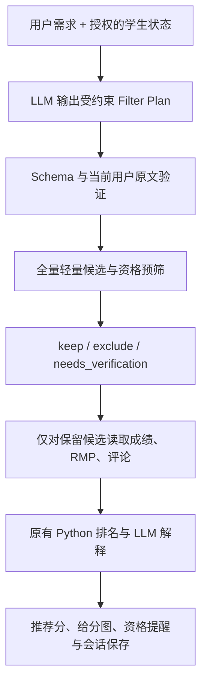

# SOLON 动态预筛实施记录

依据 [SOLON Dynamic Prefilter Implementation Plan](SOLON_Dynamic_Prefilter_Implementation_Plan.md)，2026-10-13 实施。只实现动态预筛 Phase 1，沿用既有固定权重排名，不实现动态权重；没有部署、修改生产 `.env`、执行数据库迁移或删除旧实现。

## 架构审计与集成位置

实际主链路：

```text
static/js/chat.js → /api/chat/stream
  → app/routers/chat.py:_stream_chat/_handle_agent
  → app/llm/adapter.py:stream_agent_response
  → app/agent/loop.py:run_agent/_run_loop
  → app/agent/tools.py:dispatch
  → app/data/db.py + CatalogView/Registrar/Anteater/RMP/Zotistics
  → propose_recommendation → cards_proposed → SSE meta
  → app/data/sessions.py:append_turn → 会话恢复
```

- 主推荐由流式 Agent 选择工具与课程，再由后端校验、补全卡片。`AGENT_SYSTEM_PROMPT` 位于 `app/llm/adapter.py`；兼容的 `ANSWER_SYSTEM_PROMPT`、`stream_answer_llm` 仍有兼容／测试／系统信息入口。本次不改旧提示词；新增独立 Filter Plan 解析提示词和开关开启时的静态 Agent 指令。
- `db.retrieve_course_candidates` 已支持按学期、院系、GE 类别及排除 ID 检索全池；旧 `search_courses` 仍返回按课程号排列的前 30 项。新路径在预筛前不调用这个截断包装器。
- `CourseRecord`/`SectionRecord` 保存课程、班号、主讲／讨论课、GE、先修、时间和来源。`db.get_sections` 已区分可靠未开课与不可用；历史 proxy 不代表目标学期教授。时间复用 `app.scheduling.service`，包括 Registrar 上午／下午共享后缀。
- 固定排名已经由 `app/recommendations/ranking.py` 计算，`app/data/recommendations.py` 读取本地 RMP/Zotistics 缓存。新路径通过可选 `candidate_pool`/`sections_by_course` 把预筛结果传入同一引擎，再取 Top K；不会重新把已排除班次带回排名。
- 学业数据可提供已通过课程与成绩，但当前没有完整、经核实的 GE 毕业审计适配器。冻结 `ge_policy.py:progress` 只接收类别计数，不能处理完整抵扣规则；`policies.py` 中也有旧静态 GE 信息。本期保留它们，不用它们猜测毕业完成状态。
- 当前 API 不接收用户自填的 `ge_audit` 验证标记；可靠审计须由受信任的后端来源提供。本期定义该输入契约和保守缺失行为，不新建完整毕业审计系统或新的数据库表。

## 新执行流程



`DYNAMIC_PREFILTER_ENABLED=true` 且为推荐请求时，在主 Agent 获取详细数据之前解析一次计划、读取轻量候选并预筛。纯开课／跨学期教授查询保持原路径。每个新推荐请求重新校验本轮硬条件；补充上下文不能悄悄恢复旧硬限制。Continue 复用同一回答的计划、候选、排除与来源快照，不重跑意图解析。

当前流式首轮同时承载自然语言和工具调用，没有可直接复用的严格 Filter Plan 输出。因此首版复用 `_call_llm(json_mode=True)` 作一次有 8 秒上限的解析，最多增加 **一次 LLM 调用／推荐请求**；默认关闭和纯查询不增加调用。没有创建第二套模型 SDK。解析耗时、调用数、失败状态均记录；将来的合并优化须另行验证工具与 JSON 输出契约。

主 Agent 收到全量保留候选的轻量索引，详细课程描述不全部灌入初始上下文。`search_courses` 可进一步缩小检索；排名开启时对完整预筛池使用原有缓存特征评分，随后取 Top K。模型对严肃候选／卡片的详细查询、成绩预取和评论分析仍复用原流程。不会对全校每门课程自动发起实时成绩请求。

工具 guard 在课程／教授详细查询前再次执行同一规则；跳过搜索直接提出课程也不能绕过预筛。评论工具的裸课程号会结合院系或唯一已知完整 ID 校验，模糊身份不会变成教授总体查询。显式刷新班次也重新预筛。最终卡片只使用剩余班次和对应教授；未知班次在排名中保留为无分候选，不能因缺分被当作不合格。

## Filter Plan 与可靠证据

严格 Pydantic 白名单，拒绝额外字段、代码／SQL、权重、错误类型、非法时间或星期。主要字段：

```json
{
  "goal": "gpa_optimization",
  "secondary_goals": [],
  "course_scope": "any",
  "hard_filters": {
    "only_unmet_ge": false,
    "earliest_start": null,
    "earliest_start_is_hard": false,
    "excluded_weekdays": []
  },
  "soft_preferences": {
    "high_a_rate": true,
    "professor_rating": "high",
    "avoid_early_classes": false,
    "avoid_weekdays": []
  },
  "explicit_constraints": [],
  "reason_summary": ""
}
```

所有硬条件必须有可定位的本轮用户原文依据，并验证其强制语义、方向、值和范围。“最好不要早八”只作偏好；“绝对不能有 10 点以前的课”可筛除违规班次。按特定星期／单门课限定或带例外的最早时间，不会扩大为全局硬条件；首版将它们降级并提示需核实。

`course_scope=ge` 也需明确选择 GE 的当前原文，不能仅因提到 GE 就排除非 GE。例如“GE 已修完，推荐容易拿 A 的课程”“不要 GE，推荐专业课”均不能升级为 GE-only。

`only_unmet_ge` 默认 false，只有明确“只要满足未完成 GE 的课”且可靠审计足够时才可 true。“尽快毕业，同时 GPA 尽量好”保留多个目标，不自动排除其他候选，也不改变固定权重。

模型关闭、超时、无效 JSON／Schema 或依据不支持的条件安全降级；不得悄悄使用更激进的排除策略。卡片显示选课条件待核实，而不是声称候选已完全符合资格。

### GE、预计抵扣、重复修读与资格

可信 `profile.ge_audit` 必须有真实布尔 `verified=true`、`authorized=true`，来源限定 `registrar_degree_audit`/`verified_academic_audit`，并提供完整有效的 `unmet_categories`。可选 `projected_categories` 必须由同一可信审计确认：表示在修课程预计覆盖该类别**全部剩余要求**，不是任意一门在修课就抵扣整个类别。在修预计贡献单列，不改成已完成；用户已确认推荐时暂不重复覆盖这些预计缺项。

GE 缺失、适用年份未知、AP／IB／转学抵扣未核实或标签不完整时，不推测完成。`CourseRecord.ge_categories_verified` 内部区分原始课程 GE 字段明确为 JSON 空列表与字段缺失／损坏；只在动态路径使用，不改变关闭开关后的旧 API 结构。部分已知标签不等于完整标签，不能据此断言多类别课程对缺项无贡献。

同 GE 类别的另一门课与同一门课重复修读分开：前者不能仅因类别已完成而排除；后者需要学校成绩／学分规则及实际记录，本期单独提示重复资格和 GPA 影响需核实，不承诺能提高 GPA。

先修硬排除只信可靠 not_met。现有已修列表并不能证明学业记录完整；IO 不把普通部分档案产生的 not_met 当成确定不合格。需要后端确认 `academic_record_complete` 与 `academic_record_verified`，否则保留并标注。已确定不可修、已确认目标学期不开课才排除；未知、缺失或历史数据不作反证。

时间按 section 筛选，不删除仍有合格 section 的整课。2026-10-20 用户新增确认：完整当期官方课表列出 Dis 时视为必选，没有 Dis 且没有未解决额外说明时无需选 Dis；课程说明及 co-class 需单独核对。原始完整课表用于判断，筛后的班次不能证明没有 Dis。多个主班或跨课程的具体关系仍须证据，不能只凭字母猜配对；Lab 等其他要求仍分别保留。详见 [Dis 规则](discussion-pairing-policy-2026-10-20.md)。未来未公布班次不填入历史教授／班号；待核实提醒按课程和目标学期隔离。

## 契约、指标与前端

纯引擎返回完整 `kept` payload、`excluded`（课程 ID／学期／原因／被排班次）、`needs_verification`、`applied_plan`、候选和班次数量。IO 保留来源，过滤后才进入原有排名；相同输入与配置的 Validator/Engine 可复现，LLM 自然语言解析本身不保证每次输出完全一致。

开关开启的卡片附 `prefilter={enabled:true,status,warnings}`，显示已有 Python 推荐分／主讲分及自然语言待核实提示。未知分数不显示假零，真正零分保留；原始成绩柱状图不使用收缩后的评分值。无 metadata 时旧卡片 HTML 保持不变。SSE 与会话记录保存非敏感预筛报告，Continue/刷新可恢复；报告不包含完整成绩单或 profile。

指标：`prefilter.parse_ms`、`parser_llm_calls`、`filter_ms`、候选输入／保留／排除／未知数量、原因计数、被 guard 阻止的详细工具、详细查询尝试数量。查询尝试包括缓存访问，不能当作真实外网请求数。日志仅记录计数、状态、枚举原因和耗时，不记录完整成绩单／身份／密钥。

## 文件与保留／清理清单

新增：

- `app/recommendations/filter_plan.py`：Schema、来源与硬条件校验。
- `app/llm/filter_plan.py`：复用 JSON 模式的有界解析及降级。
- `app/recommendations/prefilter.py`：无 I/O 的纯预筛。
- `app/agent/prefilter.py`：轻量检索、请求快照、数据 guard 和指标。
- `tests/test_filter_plan.py`、`test_dynamic_prefilter_engine.py`、`test_dynamic_prefilter_integration.py`、`test_dynamic_prefilter_cards.py`。
- `scripts/benchmark_dynamic_prefilter.py`、本记录。

修改：

- `app/config.py`、`.env.example`：独立默认关闭开关。
- `app/catalog/types.py`、`loaders/uci_relational.py`：内部 GE 数据完整性标记，保留旧输出。
- `app/agent/loop.py`、`tools.py`：预筛入口、工具 guard、班次／卡片整合及续答快照。
- `app/data/recommendations.py`：复用预筛后完整池和剩余班次，不改变默认排名路径。
- `app/data/sessions.py`、`app/routers/chat.py`：可选预筛报告的 SSE／会话保存，关闭时不增加旧字段。
- `static/js/cards.js`、`static/styles/components.css`：分数与待核实提示。
- `README.md`、`docs/term-rules.md`：入口及职责边界。

2026-10-13 实施时**待删除项：无；已批准删除项：无；实际删除项：无**。以下未批准候选继续保留：

| 候选 | 可能后续整理原因 | 当前依赖／风险与保留方案 |
| --- | --- | --- |
| `adapter.py:ANSWER_SYSTEM_PROMPT/stream_answer_llm` | 与主 Agent 有兼容重叠 | 系统信息、兼容函数、live 测试和安全／语言测试仍引用；本期完全保留 |
| `ge_policy.py:progress` 及 `policies.py` 的静态 GE 规则 | 与实际审计粒度不一致 | 本期不作为可信毕业审计；保留到独立规则整理任务，删除／替换前需逐项审批 |
| `db.py:search_courses` 前 30 项包装 | 新路径用全池 | 开关关闭与旧调用依赖此契约；保留为明确回滚路径 |

这些只是候选，不是拟执行删除清单；任何实际删除仍须按用户计划第 7 节重新提交准确范围、原文 diff、引用分析并获批准。初次实施没有删除审批请求。

2026-10-19，用户明确批准此前审计清单的 D-001～D-008，并要求先保存当前版本。已建立并校验清理前快照，仅清理这八项无调用兼容函数、旧按钮辅助代码和样例文件；上表三项及 D-009～D-012 继续保留。具体范围、恢复方法和验证见 [D-001～D-008 清理记录](cleanup-d001-d008.md)。

2026-10-19 后续：用户逐项批准 P-001～P-016 的 Prompt／激活条件修整，旧兼容链路仍保留。主 Agent 已明确两个独立开关、动态意图到预筛的顺序及后端评分责任；`FilterPlan` 使用省略默认字段的短 JSON 和有效证据对象示例，推荐数量不是硬筛选证据。解析仍为一次有界调用，默认限制 12 秒（`FILTER_PLAN_TIMEOUT_SECONDS` 可配置，范围 0.05～20 秒），失败不得视为用户取消条件。`requested_plan`、`applied_plan`、`unresolved_constraints` 和 `recommendation_gate` 分列；解析失败、缺少可信审计的“仅剩余 GE”、遗漏或不支持的明确硬时间要求暂停正式推荐与重数据查询，保留澄清能力。普通 GE 请求仍不要求个人 GE 审计。在修预计抵扣仍与已完成分开。

正常、Continue、预算结尾共享最新运行时指令。未知时间和配对候选仍留在服务端池内，但正式出卡仅使用能核实所需时间条件的班次组合；隐藏 TBA 组件不能消除原有配对不确定性。首次模型上下文改为计划、数量和院系／排除原因统计，完整候选及详细排除仍保留在服务端与报告，未恢复“按课程号取前 30 再筛选”。`search_courses` 按实际开关和数据返回契约解释完整池排名。工具文本区分本地缺失与官方未开课、规划先修与已通过、时间不重叠与完整注册资格。评论总结使用新版本缓存键，旧缓存文件和条目保留。默认 Prompt 只读预览与用户风格扩展分离，不清除已有用户设置。实施与真实验收结果见本次 P-001～P-016 记录。

## 启用、回滚与测试

```dotenv
# 独立启用预筛；不需要改变任何生产数据或迁移。
DYNAMIC_PREFILTER_ENABLED=true
# 需要现有固定推荐分与排序时，同时显式启用：
RECOMMENDATION_RANKING_ENABLED=true
```

重启服务后生效。回滚只需将 `DYNAMIC_PREFILTER_ENABLED=false` 并重启，恢复旧检索／工具／卡片路径；两个开关互不自动修改。`RECOMMENDATION_RANKING_ENABLED=false` 时保留既有推荐流程，不伪造数值分数。源码提交、生产开关切换、部署均未执行。

```sh
.venv/bin/python -m pytest tests/test_filter_plan.py \
  tests/test_dynamic_prefilter_engine.py tests/test_dynamic_prefilter_integration.py \
  tests/test_dynamic_prefilter_cards.py --no-cov -q
.venv/bin/python -m pytest -m 'not live and not manual' --no-cov -q
.venv/bin/python scripts/benchmark_dynamic_prefilter.py
```

还需运行 `docs/term-rules.md` 中规定的八文件回归。可选真实 Chrome 测试启用 `SOLON_BROWSER_CHECK=1`，使用合成 fixtures、禁止外网；测试与真实 LLM/线上保证应区分。

离线 benchmark 的 8 组人工标注合成案例中，预期保留 7 门、实际保留 7 门，误删 0、误保留 0。35 门硬时间案例保留第 35 门，模拟详细查询由 70 次降到 2 次；100 次纯规则运行的中位数约 0.35 ms。该测量不含网络、LLM、目录构建与真实学业审计，不能代表线上延迟、实际 API 节省或真实推荐质量。真实模型的新旧推荐差异尚未评测；确定性测试验证默认路径、评分输入和卡片输出的差异。

最终验证（2026-10-13）：

- 完整离线套件 **1008 passed**，4 个可选浏览器测试跳过，2 个 live/manual 测试未运行。
- 规定学期回归 **134 passed**，包含在完整离线套件中，不另加总。
- 启用真实 Chrome 的动态卡片、原给分图、Continue 与静态前端检查合计 **58 passed**；无外网请求，桌面与手机截图已人工查看。
- 合成 benchmark 的误删率为 **0/7**、召回率 **100%**；只限该标注集合，不推及真实用户。
- `git diff --check` 通过。关闭开关后的旧 HTML／API、默认时间标签、原始给分口径及既有回归均通过。

未验证真实模型的新旧输出质量或线上整体延迟；未部署或开启生产开关。Phase 2（动态权重或反馈学习）仍未实施。

## 2026-10-20：F-001～F-004 证据与展示修复

按用户逐项批准，配对采用同课程同学期的可信三态规则，GE 类别未知不被自由理由覆盖，成绩范围不混算为个人风险或同课差值。任一新推荐开关开启时，推荐正文与卡片理由由后端根据当前选择的证据生成；工具进度、卡片和继续查询保留。GPA/兴趣请求不强制变成个人 GE 缺项流程。旧兼容链路与默认关闭状态保留，未上线。

修改前 384 文件备份、具体案例、本地回归、只读余额检查及待补 C2～C5/C1 专项见 [本轮实施记录](recommendation-f001-f004-2026-10-20.md)。已保存记录的确定性重放不计为新的真实 LLM 验收；余额尚未恢复时不发送新的模型请求。

## 2026-10-20：S-001～S-003 真实来源补证

补齐官方年度 GE 名单与目标学期 WebSoc 配对证据生产，按需接入详细查询前的预筛，按主班验证完整组合后再查询成绩/评分。来源身份、快照时间、配套要求和实际选择分开显示。真实 SOCIOL 1 的 B/C 正例及 A/PHILOS 3 未知反例经过生产解析链和本地界面验证；公共默认开关不变，本地开发保持用户已授权的开启状态。备份、变更范围和验收边界见 [S 系列记录](recommendation-s001-s003-2026-10-20.md)，未上线，未重新调用真实 LLM。
